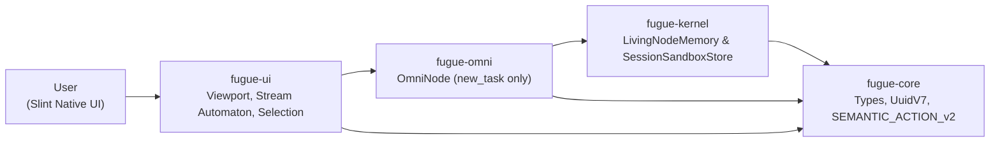

<div align="center">

# Fugue

**Ultra-Lightweight, Zero-Cost-Abstraction AI Agent Runtime & Native Desktop Workbench in Rust**

[](https://www.rust-lang.org/)
[](https://slint.dev/)
[](#architectural-axioms)
[](LICENSE)

**English** | [简体中文](README.zh-CN.md) | [繁體中文](README.zh-HK.md)

</div>

---

## Overview

**Fugue** is a high-performance, ultra-lightweight AI agent orchestration runtime and native desktop workbench engineered from the ground up in **Rust** and **Slint**.

Designed around **zero-cost abstractions**, **event-driven execution**, and **strict architectural invariants**, Fugue eliminates bloated Electron runtimes, centralized polling loops, and monolithic agent prompts. From single-turn instant queries to multi-stage parallel agent meshes, Fugue delivers native desktop responsiveness with deterministic memory safety.

---

## Key Features

### Core Agent Runtime (`fugue-core`, `fugue-kernel`, `fugue-omni`)
- **Strict Tool Purity (`AXIOM[03]`)**: The user-facing `OmniNode` exposes **only** `new_task` (`OmniToolManifest`), completely preventing direct side effects at the facade layer and enforcing sandboxed capability delegation.
- **Lock-Free Living Memory (`LivingNodeMemory`)**: Peer instances collaborate via CAS optimistic lease locks (`acquire_lease`) and a `tokio::sync::broadcast` event bus—zero centralized polling loops.
- **RFC 9562 Monotonic `UuidV7`**: Lock-free, strictly monotonic 128-bit identifiers for sessions and messages.
- **Zero-Copy Multi-Session Sandbox (`SessionSandboxStore`)**: Isolated per-user filesystem storage (`~/.fugue`) backed by `memmap2` memory-mapped I/O, 32-byte fixed message index entries, and 64-byte cache-line-aligned 512-bit N-gram bitmap signatures for ultra-fast full-store search.
- **9 Built-in Client Control Interfaces (`ClientControlCommand`)**: Strongly-typed protocol and OpenAI/DeepSeek Tool JSON Schemas allowing models to safely invoke reserved client UI state interfaces (such as theme and language preferences).

### Native Slint Workbench (`fugue-ui`)
- **O(log N) Virtualized Viewport Culling**: `FenwickViewportIndex` (Binary Indexed Tree + binary lifting) computes visible block ranges and updates measured heights in place.
- **Lenis-Style Smooth Scrolling**: Frame-rate-independent exponential damping (`duration = 1.2`, `lerp = 0.1`) with intelligent sticky-bottom tracking during streaming.
- **Prefix-Monotonic Streaming Markdown Automaton**: Zero-backtracking incremental parser supporting 16 block types—headings, task lists, GFM aligned tables (with one-click Markdown/TSV copy), blockquotes, Mermaid vector flowcharts, and code blocks with line numbers & word-wrap toggle.
- **Chrome-Parity Cross-Block Text Selection**: Exact glyph advance measurement (`fontdb` + `ttf-parser`) for accurate character-level hit-testing, word/paragraph expansion, and partial-slice clipboard serialization.
- **Cross-Line Syntax Highlighting & LaTeX Math**: Multi-line token state tracking (block comments, triple-quoted/template strings), 4-space tab alignment, and `latex-rust` PNG math rendering with `OnceLock` font singleton, bounded `Arc<[u8]>` cache, and Unicode fallback.
- **Off-Thread Async I/O & SSE Streaming**: Dedicated Tokio I/O worker (`AsyncIoHandle`) keeps disk persistence and search off the UI thread, paired with a cancelable DeepSeek SSE streaming client (`deepseek_client`).

---

## Architectural Axioms

Fugue adheres to **6 non-negotiable architectural axioms** (`PROTOCOL_VERSION: 2.4.0-STRICT`):

| Axiom | Principle | Summary |
| :--- | :--- | :--- |
| **AXIOM[01]** | Dynamic Range Invariance | **L0** tasks pass through with zero orchestration overhead; **L1/L2** tasks dynamically expand into a peer mesh. |
| **AXIOM[02]** | Sole User-Facing Facade | `Omni` is the single user-facing entity. Internal `TaskNode` and worker units remain hidden and converge into `LivingNodeMemory`. |
| **AXIOM[03]** | Omni Tool Purity | `Omni` physically exposes **only** `new_task`. File I/O, shell execution, and network tools are strictly forbidden on `Omni`. |
| **AXIOM[04]** | Node as Peer Cluster | Nodes are peer instance clusters operating over `LivingNodeMemory` via atomic CAS optimistic locking. |
| **AXIOM[05]** | Ephemeral Blank Slate | Instances spawn as blank slates with zero hardcoded context; state continuity lives exclusively in `LivingNodeMemory`. |
| **AXIOM[06]** | Concurrent Avatars | Planning Avatar and Action Avatar overlap concurrently, driven bottom-up by structured `SEMANTIC_ACTION_v2` telemetry. |

---

## Architecture



### Workspace Layout

```text
Fugue/
├── Cargo.toml                  # Workspace root & release/dev optimization profiles
├── AGENTS.md                   # Architectural axioms & engineering charter
├── start.bat                   # Windows one-click build & launch script
├── LICENSE                     # GNU General Public License v3.0
└── crates/
    ├── fugue-core/             # Zero-dependency domain models, UuidV7, protocol schemas
    ├── fugue-kernel/           # LivingNodeMemory, CAS leases, event bus, SessionSandboxStore
    ├── fugue-omni/             # OmniNode runtime, new_task manifest guard, system prompt
    └── fugue-ui/               # Slint GUI, Fenwick culler, streaming parser, selection, SSE client
```

---

## Quick Start

### Prerequisites
- **Rust Toolchain**: Edition 2021+ (`rustup` / `cargo`)
- **API Key**: A DeepSeek-compatible API key for LLM streaming

### 1. Clone the Repository

```bash
git clone https://github.com/Nya-Angle/Fugue.git
cd Fugue
```

### 2. Configure Environment Variables

Create a `.env` file in the repository root (do **not** commit this file):

```env
DEEPSEEK_API_KEY=your_api_key_here
# Optional: defaults to https://api.deepseek.com
DEEPSEEK_BASE_URL=https://api.deepseek.com
```

### 3. Build & Run

```bash
# Development run (dependencies are compiled with opt-level = 2 for smooth Slint rendering)
cargo run

# Or on Windows, double-click or run:
start.bat

# Optimized release build (LTO + single codegen unit + stripped binary)
cargo build --release
```

### Shortcuts & Controls
- `Ctrl + B` — Toggle collapsible session sidebar
- `Ctrl + N` — Create a new isolated session
- `ESC` — Close settings panel or active overlays

---

## Development & Verification

Before submitting changes, verify the workspace passes all checks:

```bash
cargo check --workspace
cargo test --workspace
cargo clippy --workspace -- -D warnings
```

---

## Data & Compliance Notice

Fugue is a local-first open-source software runtime and desktop workbench. All session history and index files are stored locally in the user's filesystem sandbox (`~/.fugue`). API credentials in `.env` are used solely to authenticate with the user-configured model endpoint. Users are responsible for complying with applicable local laws, regulations, and the terms of service of their chosen model providers.

---

## License

This project is licensed under the **GNU General Public License v3.0 (GPL-3.0)** — see the [LICENSE](LICENSE) file for details.
