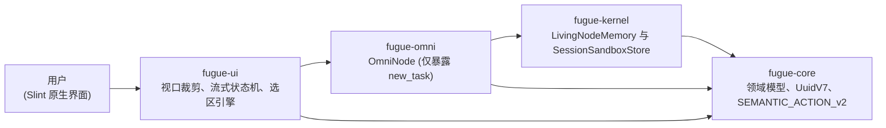

<div align="center">

# Fugue

**基于 Rust 构建的超轻量、零成本抽象 AI 智能体运行时与原生桌面工作台**

[](https://www.rust-lang.org/)
[](https://slint.dev/)
[](#核心架构公理)
[](LICENSE)

[English](README.md) | **简体中文** | [繁體中文](README.zh-HK.md)

</div>

---

## 项目简介

**Fugue** 是一个以**极致性能**与**超轻量**为核心准则，使用 **Rust** 与 **Slint** 从零构建的高性能 AI 智能体编排运行时与原生桌面交互工作台。

围绕**零成本抽象**、**事件驱动执行**与**严格架构公理**设计，Fugue 彻底摒弃臃肿的 Electron 运行时、中心化轮询调度线程与固化巨型提示词。无论是毫秒级响应的单轮问答，还是动态展开的多阶段并行智能体协作网格，Fugue 都能在确定性内存安全的前提下提供原生级桌面交互体验。

---

## 核心特性

### 智能体核心运行时（`fugue-core`、`fugue-kernel`、`fugue-omni`）
- **工具纯洁性约束（`AXIOM[03]`）**：对外唯一门面 `OmniNode` 仅暴露 `new_task`（由 `OmniToolManifest` 强校验），物理隔离文件读写、Shell 与网络等副作用，专职意图编译与沙箱赋权。
- **无锁活体记忆（`LivingNodeMemory`）**：对等节点实例通过 CAS 乐观租约锁（`acquire_lease`）与 `tokio::sync::broadcast` 事件广播总线协同工作，不采用中心化轮询调度循环。
- **RFC 9562 单调递增 `UuidV7`**：无锁、严格单调递增的 128-bit 会话与消息唯一标识符。
- **零拷贝多会话沙箱存储（`SessionSandboxStore`）**：基于 `~/.fugue` 的独立文件系统沙箱，集成 `memmap2` 内存映射零拷贝 I/O、32 字节定长消息偏移索引与 64 字节缓存行对齐的 512-bit N-Gram 位图签名，实现极速双层全文检索。
- **9 项客户端控制接口（`ClientControlCommand`）**：强类型客户端控制指令与 OpenAI/DeepSeek Tool JSON Schema，支持大模型通过标准 Tool Calling 协议安全调用客户端预留接口（如主题、语言等视图状态切换）。

### 原生 Slint 桌面工作台（`fugue-ui`）
- **O(log N) 虚拟化视口裁剪**：`FenwickViewportIndex`（树状数组 + 树上倍增二分查找）精准计算可视块区间并原位更新实测高度，轻松承载超长对话流。
- **Lenis 物理阻尼平滑滚动**：帧率无关的指数阻尼引擎（`duration = 1.2`，`lerp = 0.1`），支持流式输出期间的智能粘性贴底。
- **前缀单调流式 Markdown 状态机**：零回溯增量解析器，支持 16 种块级渲染类型——标题、任务复选框列表、GFM 对齐表格（内置一键 Markdown/TSV 复制）、引用导轨、Mermaid 矢量流程图以及带行号和自动折行开关的代码块。
- **Chrome 级跨块字符选区引擎**：基于 `fontdb` + `ttf-parser` 精确测量字形步进，实现字符级命中测试、双击选词/三击选段与局部切片剪贴板序列化。
- **跨行语法高亮与 LaTeX 公式渲染**：支持块注释/三引号/模板字符串跨行状态追踪、4 空格 Tab 对齐；集成 `latex-rust` PNG 公式渲染、`OnceLock` 字体单例、有界 `Arc<[u8]>` 缓存及 Unicode 自动降级。
- **离屏异步 I/O 与 SSE 流式客户端**：独立 Tokio I/O 工作线程（`AsyncIoHandle`）将磁盘持久化与全库检索移出 UI 线程，配合可中断的 DeepSeek SSE 流式客户端（`deepseek_client`）。

---

## 核心架构公理

Fugue 严格遵守 **6 项不可违背的架构公理**（`PROTOCOL_VERSION: 2.4.0-STRICT`）：

| 公理 | 名称 | 核心约束 |
| :--- | :--- | :--- |
| **AXIOM[01]** | 动态复杂度自适应 | **L0** 任务零编排开销单实例直通；**L1/L2** 任务动态展开为对等协作网格，避免阻塞等待。 |
| **AXIOM[02]** | 唯一对外交互门面 | **Omni** 是唯一面向用户的交互实体；内部 `TaskNode` 与执行单元对用户透明，结果收敛至 `LivingNodeMemory`。 |
| **AXIOM[03]** | Omni 物理工具纯洁性 | `Omni` 物理可用工具**有且仅有** `new_task`，严禁挂载文件编辑、Shell 执行或网络抓取工具。 |
| **AXIOM[04]** | 节点即对等集群 | 所有节点皆为无从属层级的对等实例集群，统一通过 CAS 乐观锁原子读写活体记忆。 |
| **AXIOM[05]** | 白板即用即毁 | 实例零预制提示词启动，上下文完全由上游注入或拉取，执行完毕即销毁释放资源。 |
| **AXIOM[06]** | 任务节点思执并发 | 思维分身（Planning Avatar）与执行分身（Action Avatar）时间轴并发重叠，由 `SEMANTIC_ACTION_v2` 遥测驱动自检。 |

---

## 架构概览



### Workspace 目录结构

```text
Fugue/
├── Cargo.toml                  # Workspace 根配置与 Release/Dev 优化 Profile
├── AGENTS.md                   # 核心架构公理与工程开发宪章
├── start.bat                   # Windows 一键构建与启动脚本
├── LICENSE                     # GNU General Public License v3.0
└── crates/
    ├── fugue-core/             # 零内部依赖：领域模型、UuidV7、遥测与控制协议 Schema
    ├── fugue-kernel/           # LivingNodeMemory 活体记忆、CAS 租约、广播总线与沙箱存储
    ├── fugue-omni/             # OmniNode 白板运行时、new_task 白名单校验与系统提示词
    └── fugue-ui/               # Slint GUI、Fenwick 视口裁剪、流式解析、选区与 SSE 客户端
```

---

## 快速开始

### 环境准备
- **Rust 工具链**：Edition 2021+（`rustup` / `cargo`）
- **API 密钥**：兼容 DeepSeek API 的密钥（用于大模型流式对话）

### 1. 克隆仓库

```bash
git clone https://github.com/Nya-Angle/Fugue.git
cd Fugue
```

### 2. 配置环境变量

在仓库根目录创建 `.env` 文件（**切勿提交至版本库**）：

```env
DEEPSEEK_API_KEY=your_api_key_here
# 可选：默认值为 https://api.deepseek.com
DEEPSEEK_BASE_URL=https://api.deepseek.com
```

### 3. 构建并启动

```bash
# 开发模式启动（依赖项已配置 opt-level = 2，保障 Slint 流畅渲染）
cargo run

# Windows 用户也可直接运行一键启动脚本：
start.bat

# 极致性能 Release 构建（开启 LTO、单 codegen unit 与符号剥离）
cargo build --release
```

### 常用快捷键
- `Ctrl + B` — 展开 / 收起多会话沙箱侧边栏
- `Ctrl + N` — 新建独立沙箱会话
- `ESC` — 关闭设置面板或当前浮层

---

## 开发与验证

提交代码前请确保工作区通过全部检查：

```bash
cargo check --workspace
cargo test --workspace
cargo clippy --workspace -- -D warnings
```

---

## 合规与数据安全说明

Fugue 为本地优先的开源软件运行时与桌面工作台。所有会话历史与检索索引文件均存储于用户本地文件系统沙箱（`~/.fugue`）；`.env` 中的 API 密钥仅用于向用户自行配置的合规模型服务端点发起鉴权请求。使用者在接入第三方大语言模型服务时，应严格遵守相关法律法规及模型服务提供商的使用规范。

---

## 开源协议

本项目基于 **GNU General Public License v3.0 (GPL-3.0)** 开源协议发布，详情请参阅 [LICENSE](LICENSE) 文件。
