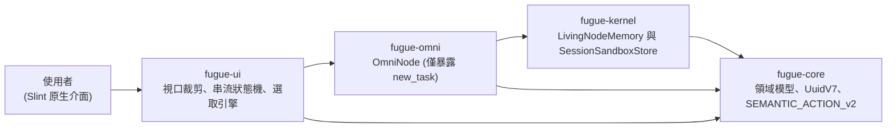

<div align="center">

# Fugue

**基於 Rust 構建的超輕量、零成本抽象 AI 智能體運行時與原生桌面工作台**

[](https://www.rust-lang.org/)
[](https://slint.dev/)
[](#核心架構公理)
[](LICENSE)

[English](README.md) | [简体中文](README.zh-CN.md) | **繁體中文**

</div>

---

## 項目簡介

**Fugue** 是一個以**極致性能**與**超輕量**為核心準則，使用 **Rust** 與 **Slint** 從零打造的高性能 AI 智能體編排運行時與原生桌面互動工作台。

圍繞**零成本抽象**、**事件驅動執行**與**嚴格架構公理**設計，Fugue 徹底捨棄臃腫的 Electron 運行時、中心化輪詢調度線程與固化巨型提示詞。無論是毫秒級響應的單輪問答，還是動態展開的多階段並行智能體協作網格，Fugue 都能在確定性內存安全的前提下提供原生級桌面互動體驗。

---

## 核心特色

### 智能體核心運行時（`fugue-core`、`fugue-kernel`、`fugue-omni`）
- **工具純潔性約束（`AXIOM[03]`）**：對外唯一門面 `OmniNode` 僅暴露 `new_task`（由 `OmniToolManifest` 強制校驗），實體隔離檔案讀寫、Shell 與網絡等副作用，專職意圖編譯與沙箱賦權。
- **無鎖活體記憶（`LivingNodeMemory`）**：對等節點實例透過 CAS 樂觀租約鎖（`acquire_lease`）與 `tokio::sync::broadcast` 事件廣播總線協同運作，不採用中心化輪詢調度循環。
- **RFC 9562 單調遞增 `UuidV7`**：無鎖、嚴格單調遞增的 128-bit 會話與訊息唯一標識符。
- **零拷貝多會話沙箱儲存（`SessionSandboxStore`）**：基於 `~/.fugue` 的獨立檔案系統沙箱，整合 `memmap2` 內存映射零拷貝 I/O、32 字節定長訊息偏移索引與 64 字節緩存行對齊的 512-bit N-Gram 位圖簽名，實現極速雙層全文檢索。
- **9 項客戶端控制接口（`ClientControlCommand`）**：強類型客戶端控制指令與 OpenAI/DeepSeek Tool JSON Schema，支援大型語言模型透過標準 Tool Calling 協議安全調用客戶端預留接口（如主題、語言等視圖狀態切換）。

### 原生 Slint 桌面工作台（`fugue-ui`）
- **O(log N) 虛擬化視口裁剪**：`FenwickViewportIndex`（樹狀數組 + 樹上倍增二分查找）精準計算可視區塊區間並原地更新實測高度，輕鬆承載超長對話串。
- **Lenis 物理阻尼平滑滾動**：幀率無關的指數阻尼引擎（`duration = 1.2`，`lerp = 0.1`），支援串流輸出期間的智能黏性貼底。
- **前綴單調串流 Markdown 狀態機**：零回溯增量解析器，支援 16 種區塊渲染類型——標題、任務複選框清單、GFM 對齊表格（內建一鍵 Markdown/TSV 複製）、引用導軌、Mermaid 向量流程圖，以及附帶行號與自動換行開關的代碼塊。
- **Chrome 等級跨區塊字符選取引擎**：透過 `fontdb` + `ttf-parser` 精確量測字形步進寬度，實現字符級點擊定位、雙擊選詞／三擊選段與局部切片剪貼板序列化。
- **跨行語法高亮與 LaTeX 數學公式渲染**：支援區塊註釋／三引號／模板字串跨行狀態追蹤、4 空白 Tab 對齊；整合 `latex-rust` PNG 公式渲染、`OnceLock` 字體單例、有界 `Arc<[u8]>` 緩存及 Unicode 自動降級。
- **離線程非同步 I/O 與 SSE 串流客戶端**：獨立 Tokio I/O 後台工作線程（`AsyncIoHandle`）將磁碟持久化與全文檢索移出 UI 線程，搭配可中斷的 DeepSeek SSE 串流客戶端（`deepseek_client`）。

---

## 核心架構公理

Fugue 嚴格遵守 **6 項不可違背的架構公理**（`PROTOCOL_VERSION: 2.4.0-STRICT`）：

| 公理 | 名稱 | 核心約束 |
| :--- | :--- | :--- |
| **AXIOM[01]** | 動態複雜度自適應 | **L0** 任務零編排開銷單實例直通；**L1/L2** 任務動態展開為對等協作網格，避免阻塞等待。 |
| **AXIOM[02]** | 唯一對外互動門面 | **Omni** 是唯一面向使用者的互動實體；內部 `TaskNode` 與執行單元對使用者完全透明，輸出收斂至 `LivingNodeMemory`。 |
| **AXIOM[03]** | Omni 實體工具純潔性 | `Omni` 實體可用工具**有且僅有** `new_task`，嚴禁掛載檔案編輯、Shell 執行或網絡擷取工具。 |
| **AXIOM[04]** | 節點即對等集群 | 所有節點皆為無從屬層級的對等實例集群，統一透過 CAS 樂觀鎖原子讀寫活體記憶。 |
| **AXIOM[05]** | 白板即用即毀 | 實例以零預製提示詞啟動，上下文完全由上游注入或拉取，執行完畢即刻銷毀釋放資源。 |
| **AXIOM[06]** | 任務節點思執並發 | 思維分身（Planning Avatar）與執行分身（Action Avatar）時間軸並發重疊，由 `SEMANTIC_ACTION_v2` 遙測驅動自檢。 |

---

## 架構概覽



### Workspace 目錄結構

```text
Fugue/
├── Cargo.toml                  # Workspace 根配置與 Release/Dev 優化 Profile
├── AGENTS.md                   # 核心架構公理與工程開發憲章
├── start.bat                   # Windows 一鍵構建與啟動腳本
├── LICENSE                     # GNU General Public License v3.0
└── crates/
    ├── fugue-core/             # 零內部依賴：領域模型、UuidV7、遙測與控制協議 Schema
    ├── fugue-kernel/           # LivingNodeMemory 活體記憶、CAS 租約、廣播總線與沙箱儲存
    ├── fugue-omni/             # OmniNode 白板運行時、new_task 白名單校驗與系統提示詞
    └── fugue-ui/               # Slint GUI、Fenwick 視口裁剪、串流解析、選取與 SSE 客戶端
```

---

## 快速開始

### 環境需求
- **Rust 工具鏈**：Edition 2021+（`rustup` / `cargo`）
- **API 密鑰**：相容 DeepSeek API 的密鑰（用於大型語言模型串流對話）

### 1. 克隆項目倉庫

```bash
git clone https://github.com/Nya-Angle/Fugue.git
cd Fugue
```

### 2. 配置環境變數

在項目根目錄建立 `.env` 檔案（**切勿提交至版本控制**）：

```env
DEEPSEEK_API_KEY=your_api_key_here
# 選填：默認值為 https://api.deepseek.com
DEEPSEEK_BASE_URL=https://api.deepseek.com
```

### 3. 構建並啟動

```bash
# 開發模式啟動（依賴項已配置 opt-level = 2，確保 Slint 流暢渲染）
cargo run

# Windows 使用者亦可直接執行一鍵啟動腳本：
start.bat

# 極致性能 Release 構建（啟用 LTO、單一 codegen unit 與符號剝離）
cargo build --release
```

### 常用快捷鍵
- `Ctrl + B` — 展開／收合多會話沙箱側邊欄
- `Ctrl + N` — 新增獨立沙箱會話
- `ESC` — 關閉設定面板或當前浮層

---

## 開發與驗證

提交變更前請確認工作區通過全部檢查：

```bash
cargo check --workspace
cargo test --workspace
cargo clippy --workspace -- -D warnings
```

---

## 合規與數據安全說明

Fugue 為本地優先的開源軟件運行時與桌面工作台。所有會話歷史與檢索索引檔案皆儲存於使用者本地檔案系統沙箱（`~/.fugue`）；`.env` 中的 API 密鑰僅用於向使用者自行配置的模型服務端點發起鑒權請求。使用者在串接第三方大型語言模型服務時，應遵守相關法律法規及模型服務供應商的使用規範。

---

## 開源協議

本項目依據 **GNU General Public License v3.0 (GPL-3.0)** 開源協議釋出，詳細內容請參閱 [LICENSE](LICENSE) 檔案。
